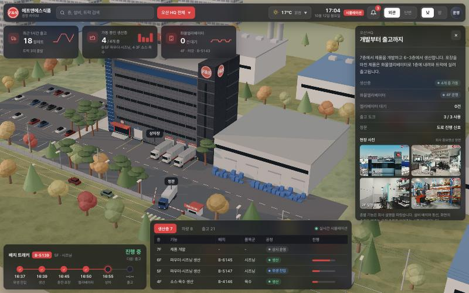

# F&S 공장 라이브

에프앤에스식품 오산 HQ의 7층 제품 개발부터 1층 출고까지를 움직이는 3D 공장 화면으로 보여주는 시안입니다. 서울 사옥과 평택 공장도 함께 볼 수 있습니다.

- 보기: <https://hanssam88.github.io/fns-factory-live/>

- 조작: 왼쪽 드래그 이동, 오른쪽 드래그 회전, 휠 확대. 건물·층·설비·엘리베이터·지게차·트럭을 누르면 카메라가 이동하고 따라갑니다.
- 상단 `외관 | 단면`: 실제 외관과 층별 내부(단면)를 바꿔 봅니다. 층을 누르면 자동으로 단면이 됩니다.
- 대시보드: 검색, 구역 선택, 날씨 4종, 시계, 알림, 낮/밤, KPI 3개, 상세 패널, 배치 트래커, 현황표.

## 표시 내용에 대해

- 화면의 숫자와 번호(출고 팔레트·대기 건수·배치·트럭 번호)는 화면 속 시뮬레이션이 만든 값입니다. 실제 생산량이나 설비 용량이 아닙니다.
- 층별 기능은 회사 설명을 따랐고, 설비 배치와 동선은 공정 흐름을 보여주기 위해 단순하게 표현했습니다.
- 상세 패널의 사진은 회사 홍보영상 장면입니다. 영상에 촬영 층이 표시되지 않은 사진은 그렇게 적었습니다.
- 서울 사옥·평택 공장은 회사 설명을 바탕으로 모양만 표현했습니다.

## FNS 월드 — 화면 9개

아티팩트 "FNS 월드 프롬프트 팩"의 9개 월드를 각각 한 파일로 만들었습니다. 모든 화면의 구역 메뉴 맨 아래에서 다른 월드로 이동할 수 있습니다.

| 번호 | 파일 | 월드 |
|---|---|---|
| 00 | `network.html` | FNS 네트워크 — 거점 공급망 지도(허브) |
| 01 | `field.html` | FNS 필드 — 원료 산지(예시) |
| 02 | `lab.html` | FNS 랩 — 기업부설연구소 |
| 03 | `index.html` | 오산 HQ 공장 라이브(이 문서 첫 화면) |
| 04 | `safe.html` | FNS 세이프 — HACCP 품질 관제 모의 점검 |
| 05 | `logis.html` | F&S 로지스 — 평택 서탄 물류창고 |
| 06 | `city.html` | FNS 딥시티 — B2B 고객사 상권(가상) |
| 07 | `run.html` | 소스101 런 — 온라인 주문 출고·배송 |
| 08 | `expo.html` | FNS 엑스포 — 해외 식품박람회 |

## FNS 네트워크 — 거점 공급망 지도 (`network.html`)

FNS 월드 팩의 00번 허브입니다. 회사 거점과 다른 월드로 이어지는 예시 거점을 하나의 지도에 잇고, 노선마다 차량이 상차 → 출발 → 경유 → 도착 → 하차 → 검수를 반복합니다.

- 거점 9곳: 회사 연혁에 있는 거점(오산 HQ·제1공장, 오산 갈곶동 공장·물류창고, 평택 서탄 물류창고)은 초록, 회사 설명에 따른 거점(평택 공장, 서울 사옥)은 파랑, 다른 월드로 이어지는 예시 거점(원료 산지, 풀필먼트 센터, 고객 상권, 수출 항만)은 회색 핀입니다.
- 거점을 누르면 상세 패널에 연혁·설명과 해당 월드로 가는 버튼이 나옵니다.
- 대시보드: 최근 1시간 도착 팔레트, 운행 중 차량, 정시 도착률, 배송 트래커, 차량·거점·오더 표, 날씨 4종, 낮/밤.
- 거점 위치·도로·거리는 상징적인 배치입니다. 차량·화물·시각·오더 번호는 시뮬레이션입니다.

## FNS 필드 — 원료 산지 (`field.html`)

FNS 월드 팩의 01번 월드입니다. 밭에서 수확한 상자가 집하장 계근 → 세척·선별 → 건조 → 저온보관을 거쳐 냉장 탑차로 오산 제1공장 방면에 출발하는 흐름을 보여줍니다.

- 고추·마늘·양파·생강 구획과 비닐하우스, 저수지·마을, 농가 작업자, 트랙터·1톤 화물차, 드론 방제, 스프링클러, 계절 4종(봄 정식·장마·한여름 수확·가을 고추 말리기), 낮/밤.
- 농장·작물·농가·구획과 화면의 수량·시세·번호는 모두 예시 시뮬레이션입니다. 실제 에프앤에스식품의 원료 구매처나 계약재배 농가가 아니며, 화면의 도매 시세도 실제 시세가 아닙니다.

## FNS 랩 — 기업부설연구소 (`lab.html`)

FNS 월드 팩의 02번 월드입니다. 고객사 샘플 의뢰가 미팅 → 원료·배합 → 조리 → 분석 → 관능평가 → 샘플 발송 → 고객사 검토를 거쳐 확정되거나 피드백으로 다시 돌아오는 흐름을 보여줍니다.

- 테스트 키친·배합실·시료 보관실·분석실·관능평가실·미팅룸·로비·샘플 발송실, 연구원 4명과 발송 담당, 시즌 4종, 낮/밤, 외관/단면.
- 로비에는 회사 연혁의 기업부설연구소 설립 인증(2016.03)과 특허 3건(2017.03 '파풍미소스 및 그 제조방법', 2018.12 '생선 및 육류의 냄새 제거용 소스 조성물', 2023.01 '치킨용 디핑 소스의 제조방법 및 그 방법에 의한 디핑 소스')을 걸었습니다. 트래커 단계는 운영 프로세스 01~03(제품 컨셉 확인·샘플 제안 및 조율·샘플 확정)에 대응합니다.
- 건물 배치는 연구 업무를 한 화면에 모은 상징적 구성입니다. 실제 제품 개발 공간은 오산 HQ 7층 테스트키친·조리실과 2층 분석·검증 실험실입니다. 고객사·의뢰·측정값·관능 점수·인물은 모두 시뮬레이션입니다.

## FNS 세이프 — HACCP 품질 관제 모의 점검 (`safe.html`)

FNS 월드 팩의 04번 월드입니다. 오산 HQ 7개 층 단면 위에 CCP 예시 지점을 띄우고, 모의 이탈이 생기면 감지 → 라인 정지 → 원인 확인 → 개선조치 → 재검증 → 해제와 해당 로트의 Hold 구역 이동을 보여주는 교육용 시나리오입니다.

- CCP 항목·한계기준·설비 배치·세척실·Hold 구역 위치는 모두 "예시"로 표시했고 실제 HACCP 계획이 아닙니다. 이탈·로트 번호·담당자 이니셜은 가상입니다.
- 인증 이력판에는 회사 연혁의 연·월만 적었습니다(KS Q ISO 9001 2011.03, ISO 22000 2018.11, FSSC 22000 2019.11, 제1공장 HACCP 2021.05).
- 운영 모드 4종(정상 가동·외부 심사일·야간 위생 세척·폭염), 낮/밤, 외관/단면.

## F&S 로지스 — 평택 서탄 물류창고 (`logis.html`)

FNS 월드 프롬프트 팩의 05번 월드입니다. 공장 셔틀 트럭 하차 → 리치트럭 랙 적치 → 출고 오더 피킹 → 랩핑 → 도크별 출고 대기열 → 상차 → 출차를 움직이는 3D 화면으로 보여줍니다.

- 대시보드: 최근 1시간 출고 팔레트, 랙 적재율, 평균 도크 대기, 도크 턴어라운드 트래커(도착 → 접안 → 하차·상차 → 검수 → 서류 → 출차), 도크·재고 로케이션·출고 오더 표.
- 날씨 4종(맑음·장마·폭설·한파), 낮/밤, 외관/단면. 구역 메뉴 아래에 오산 HQ 화면으로 가는 링크가 있습니다.
- 사실로 쓴 것은 회사 연혁의 "2021.06 평택 서탄면 소재 물류창고 추가 확장"뿐입니다. 창고 안 구성, 도크 수, 차량, 행선지와 화면의 수치·번호는 입출고 흐름을 보여주기 위한 시뮬레이션입니다.

## FNS 딥시티 — B2B 고객사 상권 (`city.html`)

FNS 월드 팩의 06번 월드입니다. 가상 상권의 치킨·분식·카페 매장이 소스를 쓰고, 재고가 줄면 자동 발주 → 생산 → 출고 → 본사 물류센터 입고 → 매장 배송 → 냉장고 보충으로 이어지는 흐름과 라이더 배달을 보여줍니다.

- 매장·브랜드·본사·역·아파트 이름은 모두 지어낸 가상 이름이고, 실제 고객사가 아닙니다. 화면 속 소스는 포장 형태(디핑 소스 컵·소스 파우치·드레싱 PET) 예시이며 특정 제품을 가리키지 않습니다.
- 운영 모드 4종(평일 저녁·금요일 밤 치킨 피크·스포츠 중계 날·장마철), 낮/밤(네온 간판), 외관/단면.
- 주문·재고·발주·차량·경로와 화면 시각은 압축한 시뮬레이션이며 실제 생산·납품 기간이 아닙니다.

## 소스101 런 — 온라인 주문 출고·배송 (`run.html`)

FNS 월드 프롬프트 팩의 07번 월드입니다. 소스101 육수 4종의 온라인 주문이 출고를 거쳐 아파트 단지 공동현관 앞까지 가는 흐름을 움직이는 3D 화면으로 보여줍니다.

- 오산 출고장 포장 → 집하 트럭 → 택배 허브 분류 → 배송 차량 → 아파트 단지 공동현관
- 풀필먼트 센터 피킹 → 분류 → 배송 차량, 센터 재고가 줄면 오산 출고장에서 보충 입고(1박스 30병 기준)
- 화면에서는 스마트스토어·자사몰 주문을 오산 출고장에서, 오픈마켓 주문을 풀필먼트 센터에서 내보냅니다.
- 대시보드: 최근 1시간 주문, 당일 출고율, 품절 임박 SKU, 주문 트래커(결제 → 포장 → 집하 → 허브 분류 → 배송 출발 → 배송 완료), 주문·SKU·입고 표, 시즌 4종(평시·명절 선물 세트·장마·연말 할인), 낮/밤, 외관/단면.
- 상품명·내용량(맑은전골육수 360g, 얼큰전골육수 350g, 닭한마리육수 330g, 황태해장국육수 350g)·실온 보관·PET 용기·외포장 30병은 제품 사실표를 따랐습니다. 가격은 넣지 않았습니다. 주문·재고·차량·배송지와 화면의 수치·번호는 시뮬레이션이고, 풀필먼트 센터와 택배 허브는 가상 시설이며 위치는 상징적으로 배치했습니다.

## FNS 엑스포 — 해외 식품박람회 (`expo.html`)

FNS 월드 팩의 08번 월드입니다. 가상의 해외 식품박람회장에서 바이어가 입장 → FNS 부스 시식 → 상담 테이블 → 명함 교환 → 샘플 요청 → 견적·계약 협의로 이어지는 흐름을 보여줍니다.

- 전시장(국가관 예시·세미나홀·푸드코트), FNS 부스(제품군 진열·시식 카운터·상담 테이블·샘플 선반), 입구 배지 스캔, 셔틀버스·주차, 저녁 리셉션, 한국어/영어 전환, 박람회 일정 4종, 낮/밤, 외관/단면.
- 박람회·국가관·바이어(회사명·국가)·방문·상담·샘플 수·MOQ·리드타임·세미나 일정은 모두 가상 시뮬레이션이고 가격은 넣지 않았습니다. 부스 패널의 제품군(소스·드레싱·시즈닝·파우더)과 회사 연혁만 사실입니다.

## 기술

9개 화면은 각각 한 파일(Three.js 0.170.0, CDN)로 동작하고, `index.html`은 `assets/photos/` 사진을 함께 씁니다. 빌드 과정이 없어 정적 호스팅에 그대로 올리면 됩니다. PC에서는 그림자 깊이(AO) 표현을 켭니다.
